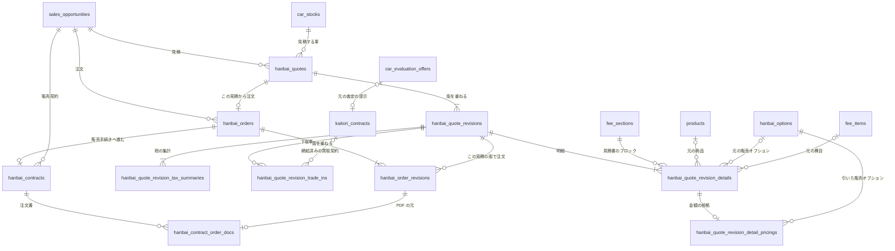

# 見積と注文の金額の持ち方：見積シートを作らず、見積の版に金額を持つ

見積シート（`hanbai_quote_sheets`）を作らず、**見積の版（`hanbai_quote_revisions`）が金額を持つ**構成である。明細・金額の根拠・税の集計・下取車は、見積の版の子にする。注文の版は見積の版を外部キー（FK）で指し、金額は見積の版から読む。

ローカル DB の `quote_revisions` は、すでに `total_amount`・`net_payment_amount`・`snapshot_json` を持っている。この構成は、その形を伸ばしたものである。

## 11/16 版からの変更

- 下取車の取り込み元を、査定の提示（`car_evaluation_offers`）から買取契約くんの締結済みの買取契約（`kaitori_contracts`）に替えた。`hanbai_quote_revision_trade_ins` は `kaitori_contract_uuid` で買取契約を指し、`car_evaluation_offer_uuid` は持たない（「下取車の参照先」の節）。
- スキーマは b11t の `origin/stg`（2773dd3b5、2026-11-17 15:46 JST）の `backend/postgresql/b11t/schema.sql` を読んだ。`origin/main`（2f6ee31f7）は stg に含まれている。

## エンティティ

登場するテーブルをすべて並べる。商談から順に、見積 → 見積の版 → 金額 → 注文 → 注文の版の並びである。

| 日本語名 | テーブル名 | 区分 | 1 行が表すもの・使い方 |
|---|---|---|---|
| 商談 | `sales_opportunities` | 既存（参照のみ） | 見積と注文の親 |
| 在庫 | `car_stocks` | 既存（参照のみ） | 見積する車 |
| スタッフ | `staffs` | 既存（参照のみ） | 見積書・注文書を出した人 |
| 見積 | `hanbai_quotes` | 新規 | 見積番号 1 つ（例：0000051155） |
| 見積の版 | `hanbai_quote_revisions` | 新規 | お客様に渡した見積書 1 枚とその金額（例：0000051155-5） |
| 明細 | `hanbai_quote_revision_details` | 新規 | 見積書の明細の 1 行（例：コーティング 49,800 円） |
| 金額の根拠 | `hanbai_quote_revision_detail_pricings` | 新規 | 販売オプションの明細 1 行を、料金表のどのマスで引いたか |
| 税の集計 | `hanbai_quote_revision_tax_summaries` | 新規 | 見積書 1 枚の、1 つの税率の合計と消費税 |
| 下取車 | `hanbai_quote_revision_trade_ins` | 新規 | 見積書に載る下取車 1 台（最大 2 台） |
| 注文 | `hanbai_orders` | 新規 | 注文番号 1 つ（例：0000032074） |
| 注文の版 | `hanbai_order_revisions` | 新規 | 注文書の元 1 回分（例：0000032074-1）。どの見積の版で注文したかを持つ |
| 販売契約 | `hanbai_contracts` | 既存（列を足す） | 1 台の販売手続き。注文から作る（例：注文番号 0000032074 の手続き） |
| 注文書 | `hanbai_contract_order_docs` | 既存（列を足す） | 注文書の PDF 1 部。注文の版ごとに 1 部作り、CloudSign で署名する |
| 買取契約 | `kaitori_contracts` | 既存（参照のみ） | 下取車の、締結済みの買取契約（買取契約くん） |
| 買取契約の支払い | `kaitori_contract_payments` | 既存（参照のみ） | 下取車の売買契約金額と、残債の有無・残債先 |
| 査定の提示 | `car_evaluation_offers` | 既存（参照のみ） | 買取契約の元になった査定の提示。下取車からは買取契約を経てたどる |
| 費目区分 | `fee_sections` | 既存（参照のみ） | 明細を見積書のどのブロックに載せるか |
| 商品 | `products` | 既存（参照のみ） | 明細の元にした商品 |
| 販売オプション | `hanbai_options` | 既存（参照のみ） | 明細の元にした保証・コーティングなど |
| 費目 | `fee_items` | 既存（参照のみ） | 明細の元にした検査登録代行などの費用 |

注文書の署名者（`hanbai_contract_order_doc_signers`）と状態履歴（`hanbai_contract_order_doc_status_events`）は今のまま変えないので、この資料では省く。

## エンティティ図

商談から順に、テーブルどうしのつながりを描いた図である。各テーブルには主キーだけを載せ、その説明に日本語名を書いている。列は次の ER 図に書く。



## 前提

- 見積と注文は、どちらも必ず商談（`sales_opportunities`）に紐づく。
- 注文は見積に紐づく。見積 1 つに注文は 1 件まで。
- 見積書No. 0000051155-5、注文書No. 0000032074-1 のように、番号は変えずに版を上げる。
- 版・明細・金額の行は、一度書いたら変えない。「最新の版」「成約したか」は親の行（見積・注文）が持つ。
- 内容を直すときは、見積の新しい版から作り直す。注文のためだけの金額は作らない。
- 販売契約は注文の後に、別のトランザクションで作る。注文 1 件に販売契約は 1 件。販売契約の無い注文は「販売手続きの前」という正常な状態である。
- 注文書は注文の版ごとに 1 部作る。注文の版が増えたら、注文書も新しく作る。

## ER 図

商談（`sales_opportunities`）から始めて、登場するテーブルをすべて 1 枚につないだ図である。既存のテーブルは、使う列だけを載せている。

```mermaid
erDiagram
  sales_opportunities ||--o{ hanbai_quotes : "見積"
  sales_opportunities ||--o{ hanbai_orders : "注文"
  car_stocks ||--o{ hanbai_quotes : "見積する車"
  hanbai_quotes ||--|{ hanbai_quote_revisions : "版を重ねる"
  hanbai_quote_revisions ||--|{ hanbai_quote_revision_details : "明細"
  hanbai_quote_revision_details ||--o| hanbai_quote_revision_detail_pricings : "金額の根拠"
  hanbai_quote_revisions ||--|{ hanbai_quote_revision_tax_summaries : "税の集計"
  hanbai_quote_revisions ||--o{ hanbai_quote_revision_trade_ins : "下取車"
  hanbai_quotes ||--o| hanbai_orders : "この見積から注文"
  hanbai_orders ||--|{ hanbai_order_revisions : "版を重ねる"
  hanbai_quote_revisions ||--o{ hanbai_order_revisions : "この見積の版で注文"
  hanbai_orders ||--o| hanbai_contracts : "販売手続きへ進む"
  sales_opportunities ||--o{ hanbai_contracts : "販売契約"
  hanbai_contracts ||--o{ hanbai_contract_order_docs : "注文書"
  hanbai_order_revisions ||--o| hanbai_contract_order_docs : "PDF の元"
  staffs o|--o{ hanbai_quote_revisions : "発行"
  staffs ||--o{ hanbai_order_revisions : "発行"
  staffs o|--o{ hanbai_contracts : "担当"
  dealer_branches o|--o{ hanbai_contracts : "販売拠点"
  kaitori_contracts |o--o{ hanbai_quote_revision_trade_ins : "締結済みの買取契約"
  kaitori_contracts ||--o| kaitori_contract_payments : "支払い"
  car_evaluation_offers |o--o| kaitori_contracts : "元の査定の提示"
  fee_sections ||--o{ hanbai_quote_revision_details : "見積書のブロック"
  products |o--o{ hanbai_quote_revision_details : "元の商品"
  hanbai_options |o--o{ hanbai_quote_revision_details : "元の販売オプション"
  fee_items |o--o{ hanbai_quote_revision_details : "元の費目"
  hanbai_options ||--o{ hanbai_quote_revision_detail_pricings : "引いた販売オプション"

  sales_opportunities {
    uuid uuid PK "商談 UUID"
    bigint display_id "表示用 ID（100001 から始まる連番）"
    uuid customer_id FK "顧客（customers.uuid）"
    bigint store_id FK "担当店舗（オフライン）"
    bigint store_staff_id FK "店舗担当スタッフ"
    bigint online_staff_id FK "オンライン担当スタッフ"
    timestamp sold_at "成約日時"
  }
  car_stocks {
    bigint id PK "在庫 ID"
    varchar stock_code "在庫コード"
    varchar vin "車台番号"
    varchar car_model_name "車名"
    varchar grade_name "グレード名"
    integer mileage_km "走行距離"
    integer sales_price "販売価格（税込）"
    bigint dealer_branch_id FK "在庫を持つ店舗"
  }
  staffs {
    bigint id PK "スタッフ ID"
    varchar last_name "姓"
    varchar first_name "名"
    bigint dealer_branch_id FK "所属店舗"
  }
  hanbai_quotes {
    bigint id PK "見積の ID"
    uuid sales_opportunity_uuid FK "NOT NULL どの商談の見積か。(id, sales_opportunity_uuid) で一意にし、注文から複合の外部キーで指す"
    bigint car_stock_id FK "NOT NULL どの車（在庫）の見積か"
    varchar quote_number UK "見積番号（例 0000051155）。初回発行時に採番する連番。DRAFT 以外は必須"
    integer current_revision_number "NOT NULL 最新の版番号。未発行は 0。版を出すたびに 1 増える"
    enum status "NOT NULL 見積の状態（DRAFT / ACTIVE / ORDERED）。既定は DRAFT"
    timestamptz created_at "NOT NULL 作成日時"
    timestamptz updated_at "NOT NULL 更新日時"
  }
  hanbai_quote_revisions {
    bigint id PK "見積の版の ID"
    bigint quote_id FK "NOT NULL どの見積の版か"
    integer revision_number "NOT NULL 第何版か。見積ごとに 1 から。見積と組で一意"
    bigint issued_by_staff_id FK "見積書を出したスタッフ。お客様の自己見積は NULL"
    varchar issued_by_staff_name "出した時点のスタッフの氏名。スタッフと両方入るか両方 NULL"
    date issued_date "NOT NULL 見積書を出した日"
    integer detail_count "NOT NULL 明細の行数"
    numeric total_amount "NOT NULL 支払総額（税込）。明細の金額の合計"
    integer trade_in_count "NOT NULL 下取車の台数。0〜2"
    numeric trade_in_amount "NOT NULL 下取額の合計。無ければ 0"
    numeric remaining_debt_amount "NOT NULL 下取車の残債の合計。無ければ 0"
    numeric net_payment_amount "NOT NULL 差引支払額 = 支払総額 - 下取額の合計 + 残債の合計"
    jsonb snapshot_json "NOT NULL 見積書に印字する内容（お客様・名義・支払方法など）"
    varchar memo "社内用のメモ。見積書には印字しない"
    timestamptz created_at "NOT NULL 作成日時"
  }
  hanbai_quote_revision_details {
    bigint id PK "明細の ID"
    bigint quote_revision_id FK "NOT NULL どの見積の版の明細か"
    integer line_no "NOT NULL 見積書に印字する順番。版の中で 1 から"
    bigint fee_section_id FK "NOT NULL 見積書のどのブロックに載せるか"
    varchar line_type "NOT NULL ITEM = ふつうの項目 / DISCOUNT = 値引き"
    varchar price_source "NOT NULL 金額の出どころ。STOCK / MASTER / CALCULATED / MANUAL"
    bigint product_id FK "商品から引いた行なら、その商品"
    bigint hanbai_option_id FK "販売オプションから引いた行なら、そのオプション"
    bigint fee_item_id FK "費目の行なら、その費目"
    varchar item_code "引いた時点の商品・オプション・費目のコード"
    varchar name "NOT NULL 見積書に出す名前"
    varchar detail "名前の横に出す補足"
    varchar discount_reason "値引きの理由。値引きの行なら必須"
    integer quantity "NOT NULL 数量。1 以上"
    numeric unit_price_incl_tax "NOT NULL 1 つあたりの金額（税込）"
    numeric amount_incl_tax "NOT NULL この行の金額（税込）。値引きはマイナス"
    numeric original_amount_incl_tax "手で直す前の自動の金額。直していなければ NULL"
    boolean is_unavailable "NOT NULL 金額を出せなかった行。true なら金額 0"
    varchar tax_category "NOT NULL 税区分（STANDARD / REDUCED / EXEMPT / NON_TAXABLE）"
    numeric tax_rate "NOT NULL 見積書を出した日の税率"
  }
  hanbai_quote_revision_detail_pricings {
    bigint quote_revision_detail_id PK, FK "NOT NULL どの明細の根拠か（販売オプションの行だけ）"
    varchar pricing_type "NOT NULL どの料金表を引いたか（保証・ケアパック・コーティング・納車陸送・店舗間移送）"
    bigint hanbai_option_id FK "NOT NULL どの販売オプションか"
    bigint price_row_id "NOT NULL 引いた料金表の行の ID"
    date price_valid_from "NOT NULL 引いた料金表の行の有効開始日"
    varchar vehicle_class_code "引いた車両区分"
    jsonb matched_keys "NOT NULL 料金表のどのマスを引いたか"
    jsonb judgment_inputs "NOT NULL マスを決めるのに使った車の値"
    timestamptz priced_at "NOT NULL 料金表を引いた日時"
  }
  hanbai_quote_revision_tax_summaries {
    bigint quote_revision_id PK, FK "NOT NULL どの見積の版の集計か"
    varchar tax_category PK "NOT NULL 税区分（明細と同じ値）"
    numeric tax_rate PK "NOT NULL 税率（明細と同じ値）"
    numeric taxable_amount_incl_tax "NOT NULL その税区分・税率の明細の合計（税込）"
    numeric consumption_tax_amount "NOT NULL その合計に含まれる消費税。税率ごとに 1 回だけ切り捨てる"
  }
  hanbai_quote_revision_trade_ins {
    bigint quote_revision_id PK, FK "NOT NULL どの見積の版の下取車か"
    smallint slot PK "NOT NULL 何台目か。1 か 2"
    uuid kaitori_contract_uuid FK "締結済みの買取契約。見積の時点は NULL でよく、注文の時点で必須。(quote_revision_id, kaitori_contract_uuid) で一意"
    numeric price "NOT NULL 下取額。買取契約の売買契約金額 - 引取の利用料 - 部品取外の工賃を写す"
    numeric remaining_debt "その車の残債。手入力。無ければ NULL"
    varchar finance_company "ローンを組んでいる信販会社。買取契約の残債先を写す。残債があれば注文の時点で必須"
  }
  hanbai_orders {
    bigint id PK "注文の ID"
    uuid sales_opportunity_uuid FK "NOT NULL どの商談の注文か。見積と同じ値"
    bigint quote_id FK, UK "NOT NULL どの見積から注文したか。見積 1 つに注文は 1 件まで。(quote_id, sales_opportunity_uuid) を見積の同じ組に複合の外部キーで結ぶ"
    varchar order_number UK "注文番号（例 0000032074）。初回発行時に採番する連番。DRAFT 以外は必須"
    integer current_revision_number "NOT NULL 最新の版番号。未発行は 0。版を出すたびに 1 増える"
    enum status "NOT NULL 注文の状態（DRAFT / ISSUED / CONTRACTED / CANCELED）。既定は DRAFT"
    integer contracted_revision_number "お客様が署名した注文の版番号。CONTRACTED なら必須"
    timestamptz contracted_at "お客様が署名した日時。CONTRACTED なら必須"
    timestamptz created_at "NOT NULL 作成日時"
    timestamptz updated_at "NOT NULL 更新日時"
  }
  hanbai_order_revisions {
    bigint id PK "注文の版の ID"
    bigint order_id FK "NOT NULL どの注文の版か"
    integer revision_number "NOT NULL 第何版か。注文ごとに 1 から。注文と組で一意"
    bigint source_quote_revision_id FK "NOT NULL どの見積の版で注文したか。注文の金額はここから読む"
    bigint issued_by_staff_id FK "NOT NULL 注文書を出したスタッフ"
    varchar issued_by_staff_name "NOT NULL 出した時点のスタッフの氏名"
    timestamptz issued_at "NOT NULL 注文書を出した日時"
    jsonb snapshot_json "NOT NULL 注文書に印字する内容（金額以外）"
    timestamptz created_at "NOT NULL 作成日時"
  }
  hanbai_contracts {
    uuid uuid PK "NOT NULL 販売契約の ID"
    varchar order_number UK "NOT NULL 注文番号（10 桁）。注文から作った契約は注文と同じ値"
    bigint hanbai_order_id FK, UK "足す列。どの注文から作ったか。注文 1 件に販売契約は 1 件まで。NULL は Extreme の受注から作った今の契約"
    varchar email "お客様のメールアドレス（320 文字まで）"
    bigint dealer_branch_id FK "販売拠点（dealer_branches.id）"
    uuid sales_opportunity_uuid FK "紐付いた商談（sales_opportunities.uuid）。NULL は未紐付け。注文から作った契約は注文と同じ値。1 商談 1 契約の一意は外す"
    bigint staff_id FK "契約の担当スタッフ（staffs.id）。商談に紐付けたときに NULL なら、商談の店舗担当（空ならオンライン担当）を入れる"
    timestamptz created_at "NOT NULL 作成日時"
    timestamptz updated_at "NOT NULL 更新日時"
  }
  hanbai_contract_order_docs {
    uuid uuid PK "NOT NULL 注文書の ID"
    uuid hanbai_contract_uuid FK "NOT NULL どの販売契約の注文書か"
    bigint order_revision_id FK, UK "足す列。どの注文の版から作った PDF か。注文の版ごとに 1 部。NULL は Extreme の受注から作った今の注文書"
    varchar order_doc_file_name "NOT NULL 注文書 PDF のファイル名"
    varchar cloudsign_document_id "CloudSign の文書 ID。NULL はまだ送っていない"
    varchar signed_pdf_file_name "締結済みの注文書 PDF の S3 のファイル名（order_doc_signed_＜注文書の ID＞_＜日時＞.pdf）。NULL はまだ取得していない"
    timestamp created_at "NOT NULL 作成日時"
    timestamp updated_at "NOT NULL 更新日時"
  }
  dealer_branches {
    bigint id PK "店舗 ID"
  }
  kaitori_contracts {
    uuid uuid PK "買取契約 UUID"
    varchar status "NOT NULL created / customer_input_url_issued / signature_url_issued / signed。下取車にできるのは signed だけ"
    varchar vehicle_pickup_method "pickup（引取）/ drop_off（持ち込み）"
    integer vehicle_pickup_fee "引取の利用料"
    integer parts_removal_fee "部品取外の工賃"
    uuid car_evaluation_offer_uuid FK, UK "元の査定の提示。オファーを経ずに作った契約は NULL"
  }
  kaitori_contract_payments {
    uuid uuid PK "支払いの ID"
    uuid kaitori_contract_uuid FK, UK "NOT NULL どの買取契約か（1:1）"
    integer contract_amount "売買契約金額（税込）"
    boolean has_loan_balance "残債の有無。残債の金額は持たない"
    varchar loan_creditor_name "残債先（信販会社）"
  }
  car_evaluation_offers {
    uuid uuid PK "査定の提示 UUID"
  }
  fee_sections {
    bigint id PK "費目区分 ID"
    varchar code UK "VEHICLE / ACCESSORY / TAX_INSURANCE / SALES_FEE / OTHER_FEE"
    varchar name "見積書に印字する名前"
    integer sort_order "見積書のブロックの並び順"
  }
  products {
    bigint id PK "商品 ID"
    varchar code "商品コード"
    varchar name "商品名"
    varchar tax_category "税区分"
    numeric price_excl_tax "税抜価格"
  }
  hanbai_options {
    bigint id PK "販売オプション ID"
    varchar code UK "オプションコード"
    varchar name "保証・ケアパック・コーティング・陸送"
    varchar option_type "WARRANTY / CARE_PACK / COATING / TRANSPORT_DELIVERY / TRANSPORT_TRANSFER"
    varchar tax_category "税区分"
  }
  fee_items {
    bigint id PK "費目 ID"
    varchar code UK "費目コード"
    varchar name "検査登録代行・車庫証明代行など"
    varchar price_entry "MASTER / MANUAL"
    varchar tax_category "税区分"
  }
```



## データの動き（シナリオごと）

山田さんが商談 `so-1` で、在庫 7001 の BRZ を買う流れで、どの行が増え・変わるかを示す。ID と金額は例である。

- 見積番号は 0000051155、注文番号は 0000032074 とする。
- 「作る」は INSERT、「変える」は親の行（見積・注文）の列の UPDATE を指す。版・明細・金額の行は、どのシナリオでも書き換えない。

### シナリオの一覧

| # | シナリオ | 作る行 | 変える行 |
|---|---|---|---|
| 1 | スタッフが見積の第 1 版を出す | 見積・見積の版・明細・金額の根拠・税の集計 | なし |
| 2 | コーティングと下取車を足して第 2 版を出す | 見積の版・明細・金額の根拠・税の集計・下取車 | 見積の `current_revision_number` |
| 3 | 第 2 版で注文する | 注文・注文の版 | 見積の `status` |
| 4 | 販売手続きへ進む | 販売契約 | なし |
| 5 | 注文書を作って CloudSign で送る | 注文書 | 注文書の `cloudsign_document_id` |
| 6 | 注文の後に、値引きを入れた見積の第 3 版を出す | 見積の版・明細・金額の根拠・税の集計・下取車 | 見積の `current_revision_number` |
| 7 | 注文の元を第 3 版に選び直す | 注文の版・注文書 | 注文の `current_revision_number` |
| 8 | 内容を変えずに注文書を作り直す | 注文の版・注文書 | 注文の `current_revision_number` |
| 9 | お客様が注文書に署名する（成約） | なし | 注文の `status`・`contracted_revision_number`・`contracted_at`、注文書の `signed_pdf_file_name` |
| 10 | 署名の前にお客様がやめる | なし | 注文の `status` |

### 1. スタッフが見積の第 1 版を出す

車両本体・検査登録手続代行費用・自動車重量税の 3 行で、支払総額 3,000,000 円の見積書を出す。

**作る行**

`hanbai_quotes`

| id | sales_opportunity_uuid | car_stock_id | quote_number | current_revision_number | status |
|---|---|---|---|---|---|
| 1 | so-1 | 7001 | 0000051155 | 1 | ACTIVE |

`hanbai_quote_revisions`

| id | quote_id | revision_number | issued_by_staff_id | detail_count | total_amount | trade_in_count | trade_in_amount | remaining_debt_amount | net_payment_amount |
|---|---|---|---|---|---|---|---|---|---|
| 11 | 1 | 1 | 501（佐藤） | 3 | 3,000,000 | 0 | 0 | 0 | 3,000,000 |

`hanbai_quote_revision_details`

| id | quote_revision_id | line_no | fee_section | price_source | name | amount_incl_tax | tax_category | tax_rate |
|---|---|---|---|---|---|---|---|---|
| 101 | 11 | 1 | VEHICLE | STOCK | 車両本体価格 | 2,900,000 | STANDARD | 0.100 |
| 102 | 11 | 2 | SALES_FEE | MASTER | 検査登録手続代行費用 | 55,000 | STANDARD | 0.100 |
| 103 | 11 | 3 | TAX_INSURANCE | CALCULATED | 自動車重量税 | 45,000 | NON_TAXABLE | 0.000 |

`hanbai_quote_revision_tax_summaries`

| quote_revision_id | tax_category | tax_rate | taxable_amount_incl_tax | consumption_tax_amount |
|---|---|---|---|---|
| 11 | STANDARD | 0.100 | 2,955,000 | 268,636 |
| 11 | NON_TAXABLE | 0.000 | 45,000 | 0 |

- 販売オプションの行が無いので、金額の根拠は作らない。
- 見積書No. は 0000051155-1 になる。

### 2. コーティングと下取車を足して第 2 版を出す

第 1 版の 3 行にコーティング 50,000 円を足し、下取車 1 台（300,000 円）を載せる。

**作る行**

`hanbai_quote_revisions`

| id | quote_id | revision_number | detail_count | total_amount | trade_in_count | trade_in_amount | remaining_debt_amount | net_payment_amount |
|---|---|---|---|---|---|---|---|---|
| 12 | 1 | 2 | 4 | 3,050,000 | 1 | 300,000 | 0 | 2,750,000 |

`hanbai_quote_revision_details`（第 2 版の分を 4 行すべて作る。第 1 版の行は使い回さない）

| id | quote_revision_id | line_no | name | amount_incl_tax | tax_category |
|---|---|---|---|---|---|
| 104 | 12 | 1 | 車両本体価格 | 2,900,000 | STANDARD |
| 105 | 12 | 2 | BUDDICA コーティング | 50,000 | STANDARD |
| 106 | 12 | 3 | 検査登録手続代行費用 | 55,000 | STANDARD |
| 107 | 12 | 4 | 自動車重量税 | 45,000 | NON_TAXABLE |

`hanbai_quote_revision_detail_pricings`（コーティングの行だけ）

| quote_revision_detail_id | pricing_type | vehicle_class_code | matched_keys |
|---|---|---|---|
| 105 | COATING | M | 車両区分 M・プラン 70 |

`hanbai_quote_revision_tax_summaries`

| quote_revision_id | tax_category | tax_rate | taxable_amount_incl_tax | consumption_tax_amount |
|---|---|---|---|---|
| 12 | STANDARD | 0.100 | 3,005,000 | 273,181 |
| 12 | NON_TAXABLE | 0.000 | 45,000 | 0 |

`hanbai_quote_revision_trade_ins`

| quote_revision_id | slot | kaitori_contract_uuid | price | remaining_debt | finance_company |
|---|---|---|---|---|---|
| 12 | 1 | kc-1（締結済みの買取契約。見積の時点では NULL でもよい） | 300,000 | NULL | NULL |

- 下取額 300,000 円は、買取契約 kc-1 の売買契約金額から引取の利用料と部品取外の工賃を引いた額を写したものである。
- 車名・車台番号・登録番号・所有者・使用者など見積書に印字する下取車の項目は、見積の版の `snapshot_json` に写す。

**変える行**

| テーブル | 列 | 前 → 後 |
|---|---|---|
| `hanbai_quotes`（id 1） | `current_revision_number` | 1 → 2 |

- 第 1 版（id 11）とその明細はそのまま残る。お客様の手元の 0000051155-1 と同じ内容をいつでも出せる。

### 3. 第 2 版で注文する

**作る行**

`hanbai_orders`

| id | sales_opportunity_uuid | quote_id | order_number | current_revision_number | status | contracted_revision_number |
|---|---|---|---|---|---|---|
| 1 | so-1 | 1 | 0000032074 | 1 | ISSUED | NULL |

`hanbai_order_revisions`

| id | order_id | revision_number | source_quote_revision_id | issued_by_staff_id |
|---|---|---|---|---|
| 21 | 1 | 1 | 12（0000051155-2） | 501（佐藤） |

**変える行**

| テーブル | 列 | 前 → 後 |
|---|---|---|
| `hanbai_quotes`（id 1） | `status` | ACTIVE → ORDERED |

- 注文の版は金額を持たない。注文の金額（支払総額 3,050,000 円・差引支払額 2,750,000 円）は、見積の版 12 から読む。
- 下取車の `kaitori_contract_uuid` は注文の時点で必須で、指す買取契約は締結済み（`signed`）でなければならない。第 2 版の下取車は締結済みの買取契約 kc-1 を持っているので注文できる。持っていなければ、買取契約を入れた見積の版を出してから注文する。
- 注文書には「注文書No. 0000032074-1 / 見積書No. 0000051155-2」と印字する。

### 4. 販売手続きへ進む

スタッフが注文から「販売手続きへ進む」を押す。注文とは別のトランザクションで作る。

**作る行**

`hanbai_contracts`

| uuid | order_number | hanbai_order_id | sales_opportunity_uuid | dealer_branch_id | staff_id |
|---|---|---|---|---|---|
| hc-1 | 0000032074 | 1 | so-1 | 3（高松店） | 501（佐藤） |

- 注文番号と商談は、注文と同じ値を入れる。
- 支払・名義などの販売手続きの入力は、この販売契約の下に入る（この資料では省く）。

### 5. 注文書を作って CloudSign で送る

**作る行**

`hanbai_contract_order_docs`

| uuid | hanbai_contract_uuid | order_revision_id | order_doc_file_name | cloudsign_document_id | signed_pdf_file_name |
|---|---|---|---|---|---|
| doc-1 | hc-1 | 21（注文の第 1 版） | order_doc_doc-1.pdf | NULL | NULL |

**変える行**

| テーブル | 列 | 前 → 後 |
|---|---|---|
| `hanbai_contract_order_docs`（doc-1） | `cloudsign_document_id` | NULL → CloudSign の文書 ID |

- 注文書は、注文の最新の版（id 21）から作る。印字する金額は、注文の版 21 → 見積の版 12 とたどって読む。
- 送ったこと・署名の依頼などの出来事は、状態履歴に積む（今のまま）。

### 6. 注文の後に、値引きを入れた見積の第 3 版を出す

成約の前なので、見積の新しい版を出せる。値引き −50,000 円を入れる。

**作る行**

`hanbai_quote_revisions`

| id | quote_id | revision_number | detail_count | total_amount | trade_in_amount | net_payment_amount |
|---|---|---|---|---|---|---|
| 13 | 1 | 3 | 5 | 3,000,000 | 300,000 | 2,700,000 |

明細は第 2 版の 4 行に、値引きの行（`line_type = DISCOUNT`・`price_source = MANUAL`・−50,000 円・理由つき）を足した 5 行を作る。金額の根拠・税の集計・下取車も、第 3 版の分を作る。

**変える行**

| テーブル | 列 | 前 → 後 |
|---|---|---|
| `hanbai_quotes`（id 1） | `current_revision_number` | 2 → 3 |

- 注文は何も変わらない。注文の版 21 は第 2 版（id 12）を指したままなので、注文の金額は 3,050,000 円のままである。
- この時点で、見積の最新の版は第 3 版、注文の元は第 2 版で、両者は一致しない。

### 7. 注文の元を第 3 版に選び直す

お客様が値引き後の第 3 版で注文し直す。

**作る行**

`hanbai_order_revisions`

| id | order_id | revision_number | source_quote_revision_id |
|---|---|---|---|
| 22 | 1 | 2 | 13（0000051155-3） |

`hanbai_contract_order_docs`

| uuid | hanbai_contract_uuid | order_revision_id | cloudsign_document_id |
|---|---|---|---|
| doc-2 | hc-1 | 22（注文の第 2 版） | 送ったら入れる |

**変える行**

| テーブル | 列 | 前 → 後 |
|---|---|---|
| `hanbai_orders`（id 1） | `current_revision_number` | 1 → 2 |

- 注文の版 21（第 2 版を元にした注文）は残る。「最初は 0000051155-2 で注文し、0000051155-3 に選び直した」ことが行で分かる。
- 未署名の注文書（doc-1）は、注文の版を足す前に CloudSign で取り下げ、状態履歴に取り消しを積む。doc-1 の行は消さない。

### 8. 内容を変えずに注文書を作り直す

宛名の誤りなどで、同じ見積の版のまま注文書を出し直す。宛名などの金額以外の内容は `snapshot_json` に入る。

**作る行**

`hanbai_order_revisions`

| id | order_id | revision_number | source_quote_revision_id |
|---|---|---|---|
| 23 | 1 | 3 | 13（前の版と同じ見積の版） |

`hanbai_contract_order_docs`

| uuid | hanbai_contract_uuid | order_revision_id | cloudsign_document_id |
|---|---|---|---|
| doc-3 | hc-1 | 23（注文の第 3 版） | 送ったら入れる |

**変える行**

| テーブル | 列 | 前 → 後 |
|---|---|---|
| `hanbai_orders`（id 1） | `current_revision_number` | 2 → 3 |

- 金額の行は 1 行も増えない。見積の版 13 を指すだけである。
- 注文書は注文の版ごとに 1 部なので、同じ内容でも注文の版を 1 つ足してから注文書を作る。前の注文書（doc-2）は取り下げる。
- 宛名などを直す内容が見積書にも載るものなら、シナリオ 6 と 7 のように見積の新しい版から作り直す。

### 9. お客様が注文書に署名する（成約）

**変える行**

| テーブル | 列 | 前 → 後 |
|---|---|---|
| `hanbai_orders`（id 1） | `status` | ISSUED → CONTRACTED |
| `hanbai_orders`（id 1） | `contracted_revision_number` | NULL → 3 |
| `hanbai_orders`（id 1） | `contracted_at` | NULL → 署名した日時 |
| `hanbai_contract_order_docs`（doc-3） | `signed_pdf_file_name` | NULL → 締結済み PDF のファイル名 |

- 版の行は書き換えない。署名した版は `contracted_revision_number` で決まる。
- 署名した金額は、注文の版 3（id 23）→ 見積の版 13 とたどって読む（支払総額 3,000,000 円・差引支払額 2,700,000 円）。
- 署名された注文書は doc-3 で、`order_revision_id` が `contracted_revision_number` の注文の版（id 23）と一致する。
- 成約した後は、この見積に新しい版を出さない。注文の版も注文書も足さない。

### 10. 署名の前にお客様がやめる

**変える行**

| テーブル | 列 | 前 → 後 |
|---|---|---|
| `hanbai_orders`（id 1） | `status` | ISSUED → CANCELED |

- 見積・見積の版・注文の版・販売契約・注文書は消さずに残す。
- 未署名の注文書を CloudSign に送っていれば、取り下げて状態履歴に取り消しを積む。

### 最後に残る行（シナリオ 1〜9 を通した場合）

| テーブル | 行数 | 中身 |
|---|---|---|
| `hanbai_quotes` | 1 | 0000051155。最新は第 3 版、状態は ORDERED |
| `hanbai_quote_revisions` | 3 | 第 1 版（3,000,000 円）・第 2 版（3,050,000 円）・第 3 版（3,000,000 円） |
| `hanbai_quote_revision_details` | 12 | 第 1 版 3 行・第 2 版 4 行・第 3 版 5 行 |
| `hanbai_quote_revision_detail_pricings` | 2 | 第 2 版と第 3 版のコーティングの行 |
| `hanbai_quote_revision_tax_summaries` | 6 | 各版 2 行（10% と不課税） |
| `hanbai_quote_revision_trade_ins` | 2 | 第 2 版と第 3 版の下取車 |
| `hanbai_orders` | 1 | 0000032074。最新は第 3 版、署名したのも第 3 版、状態は CONTRACTED |
| `hanbai_order_revisions` | 3 | 第 1 版（元は見積の第 2 版）・第 2 版（元は第 3 版）・第 3 版（元は第 3 版） |
| `hanbai_contracts` | 1 | 注文 0000032074 の販売手続き |
| `hanbai_contract_order_docs` | 3 | doc-1（注文の第 1 版・取り下げ）・doc-2（第 2 版・取り下げ）・doc-3（第 3 版・署名済み） |

## 下取車の参照先

見積の下取車（`hanbai_quote_revision_trade_ins`）は、買取契約くんの買取契約（`kaitori_contracts`）を指す。

| 決まり | 中身 |
|---|---|
| 指す列 | `kaitori_contract_uuid`（`kaitori_contracts.uuid` への外部キー）。`car_evaluation_offer_uuid` は持たない |
| 査定の提示 | 買取契約の `car_evaluation_offer_uuid` からたどる。オファーから作った買取契約は 1 つのオファーに 1 つ（`kaitori_contracts_car_evaluation_offer_uuid_uk`） |
| 見積の時点 | NULL でよい。買取契約の無い下取車を手入力で載せられる |
| 注文の時点 | 必須。指す買取契約は締結済み（`signed`）であること。状態は外部キーで縛れないので、注文を作る処理で確かめる。締結済みの買取契約は書き換えられない（`kaitori_contract_edit_locked`）ので、注文の後に中身が変わることは無い |
| 同じ版の 2 台 | 同じ買取契約を 2 回載せない。`(quote_revision_id, kaitori_contract_uuid)` で一意 |
| 下取額 `price` | 売買契約金額（`kaitori_contract_payments.contract_amount`）− 引取の利用料（`vehicle_pickup_method = pickup` のときの `vehicle_pickup_fee`）− 部品取外の工賃（`parts_removal_fee`）を写す。自動車税の未納額は引かない |
| 残債 `remaining_debt` | 手入力。買取契約は残債の有無（`has_loan_balance`）と残債先だけを持ち、残債の金額を持たない |
| 信販会社 `finance_company` | 買取契約の残債先（`loan_creditor_name`）を写す |
| 車の項目 | 車名・グレード・色・走行距離・初度登録・車検期限・型式・車台番号・登録番号・所有者・使用者は、買取契約の車（`kaitori_contract_vehicles`）から見積の版の `snapshot_json` に写す |

商談から下取車の候補（締結済みの買取契約）へは、次の順でたどる。オファーを経ずに作った買取契約は商談とつながらないので、候補に出ない。

```
商談（sales_opportunities）
  └ 商談の買取対象（my_car_sales_opportunities）… 失注していないもの
      └ 愛車（my_cars）
          └ 査定（car_evaluation_requests）
              └ 査定の提示（car_evaluation_offers）
                  └ 買取契約（kaitori_contracts）… status = signed
```

dealer-dashboard の試作（`feat/quote-trade-in-from-kaitori-contract` の d7633759f、未 push）は、この順で既存の admin-api を呼んで候補を作る。

## この構成のメリット

### 1. 見積の版 1 行 = お客様に渡した見積書 1 枚

見積の版の 1 行に、「誰が・いつ出したか」「いくらか（支払総額・下取額・差引支払額）」「何を印字したか」がそろう。お客様の手元の紙と DB の行が 1 対 1 で、初めて読む人も「この行がこの見積書」と迷わない。見積シートのように、版と 1 対 1 の別テーブルを「なぜ分かれているのか」と説明する必要が無い。

### 2. テーブルと結合が少ない

見積シートのテーブルが無い分、テーブルが 1 つ少ない。よく使う読み方が、どれも結合 1 回で済む。

商談の画面で、見積ごとに最新の版の金額を出す：

```sql
SELECT q.quote_number || '-' || r.revision_number AS quote_doc_no, r.total_amount, r.net_payment_amount
FROM hanbai_quotes q
JOIN hanbai_quote_revisions r
  ON r.quote_id = q.id AND r.revision_number = q.current_revision_number
WHERE q.sales_opportunity_uuid = $1;
```

注文書に、注文した見積書No. と金額を出す：

```sql
SELECT r.total_amount, r.net_payment_amount, r.revision_number
FROM hanbai_order_revisions orv
JOIN hanbai_quote_revisions r ON r.id = orv.source_quote_revision_id
WHERE orv.id = $1;
```

見積シートがあると、どちらも「版 → 見積シート」の結合が 1 回ずつ増える。

### 3. 注文の版から、見積書No. と金額が同じ行で取れる

注文の版が指す見積の版が、見積書No.（0000051155-5）の版番号と、注文した金額の両方を持っている。注文書を作るときに、別々のテーブルから集めて組み合わせる必要が無い。

### 4. 見積の版を出す処理が素直

見積の版を出すときは、1 つのトランザクションで「見積の版 → 明細・根拠・税の集計・下取車」の順に書くだけである。見積シートを先に作って、その ID を見積の版に入れる、という順番の約束が要らない。

### 5. ローカル DB からの移行が小さい

ローカル DB の `quote_revisions` は、すでに `total_amount`・`net_payment_amount`・`snapshot_json`・`memo` を持っている。この構成への変更は次のとおりで、見積の版の役割は変わらない。

- 見積の版に、下取額・残債・明細の行数などの合計の列を足す
- 明細・根拠・税の集計・下取車を、見積の版の子として持つ
- 注文の版から金額の列（`total_amount`・`net_payment_amount`）を外し、見積の版から読む

### 6. 守りたい決まりを、普通の外部キーで書ける

| 決まり | 守り方 |
|---|---|
| 注文の商談は、その見積の商談と同じ | `(quote_id, sales_opportunity_uuid)` を見積の同じ組に複合の外部キーで結ぶ |
| 注文の版が指すのは、その注文の見積の版だけ | `order_revisions` に `quote_id` を持たせ、`(order_id, quote_id)` を注文に、`(source_quote_revision_id, quote_id)` を見積の版に、複合の外部キーで結ぶ |
| 署名した版は、その注文の版 | `(id, contracted_revision_number)` を注文の版の `(order_id, revision_number)` に複合の外部キーで結ぶ |
| 見積 1 つに注文は 1 件 | `hanbai_orders.quote_id` の一意 |

見積の版が金額を持っているので、「注文の金額は選んだ見積の版の金額と同じ」は、注文の版が見積の版を指すだけで成り立つ。金額を写さないので、食い違いを確かめる仕組みが要らない。

### 7. 名前で迷わない

「見積」「見積の版」の 2 つだけで、「見積シート」という 3 つ目の言葉が無い。画面・帳票・会話の「見積書」が、そのまま見積の版を指す。

## デメリットと手当て

| デメリット | 手当て |
|---|---|
| 見積の版の列が多くなる（帳票の情報と金額の合計が 1 つのテーブルに混ざる） | 合計の列は 6 つで、明細などの中身は子のテーブルにある。列が増えるのは合計だけである |
| 金額の検査（総額 = 明細の合計、税の計算）を見積の版に付ける | 見積の版は書いたら変えないので、検査はコミットの時に 1 回で足りる。版を足す処理と同じトランザクションで確かめればよい |
| 金額の形を、ほかの帳票（請求書など）で使い回せない | 使い回す帳票ができたときに、その帳票から見積の版を指す |
| 注文の段階で金額を変える業務ができたら、注文用の金額の入れ物を新たに作る | 前提の決まり（内容を直すときは見積の新しい版から）が続く限り起きない。決まりが変わるときに作る |
| 見積の版と明細が書き換わると、署名済みの注文書の中身まで変わる | 見積の版とその子の行の UPDATE・DELETE をトリガで止める。注文の版からの外部キーは削除で連鎖させない（`NO ACTION`） |

## 読む場所のまとめ

| 知りたいこと | 読む場所 |
|---|---|
| 見積の最新の版 | `hanbai_quotes.current_revision_number` の見積の版 |
| 見積書の金額 | 見積の版の `total_amount`・`net_payment_amount` など。内訳は明細 |
| どの見積の注文か | `hanbai_orders.quote_id` |
| 今の注文の金額と、元にした見積書No. | `hanbai_orders.current_revision_number` の注文の版 → `source_quote_revision_id` の見積の版 |
| お客様が署名した金額 | `hanbai_orders.contracted_revision_number` の注文の版 → `source_quote_revision_id` の見積の版 |
| 注文の販売手続き | `hanbai_contracts.hanbai_order_id` が注文の ID の行 |
| 注文の版から作った注文書 | `hanbai_contract_order_docs.order_revision_id` が注文の版の ID の行 |
| 下取車の元の買取契約 | `hanbai_quote_revision_trade_ins.kaitori_contract_uuid` の買取契約。査定の提示はその `car_evaluation_offer_uuid` |
