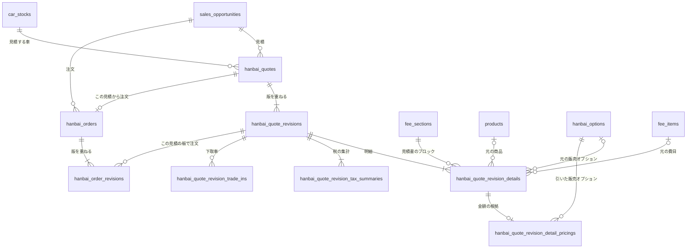

# 見積と注文の金額の持ち方

## エンティティ

登場するテーブルをすべて並べる。商談から順に、見積 → 見積の版 → 金額 → 注文 → 注文の版の並びである。

| 日本語名 | テーブル名 | 区分 | 1 行が表すもの・使い方 |
|---|---|---|---|
| 商談 | `sales_opportunities` | 既存（参照のみ） | 見積と注文の親 |
| 在庫 | `car_stocks` | 既存（参照のみ） | 見積する車 |
| スタッフ | `staffs` | 既存（参照のみ） | 見積書・注文書を出した人 |
| 見積 | `hanbai_quotes` | 新規 | 見積番号 1 つ（例：0000051155） |
| 見積の版 | `hanbai_quote_revisions` | 新規 | お客様に渡した見積書 1 枚とその金額（例：0000051155-5） |
| 明細 | `hanbai_quote_revision_details` | 新規 | 見積書の明細の 1 行（例：コーティング 49,800 円） |
| 金額の根拠 | `hanbai_quote_revision_detail_pricings` | 新規 | 販売オプションの明細 1 行を、料金表のどのマスで引いたか |
| 税の集計 | `hanbai_quote_revision_tax_summaries` | 新規 | 見積書 1 枚の、1 つの税率の合計と消費税 |
| 下取車 | `hanbai_quote_revision_trade_ins` | 新規 | 見積書に載る下取車 1 台（最大 2 台） |
| 注文 | `hanbai_orders` | 新規 | 注文番号 1 つ（例：0000032074） |
| 注文の版 | `hanbai_order_revisions` | 新規 | 注文書の元 1 回分（例：0000032074-1）。どの見積の版で注文したかを持つ |
| 査定の提示 | `car_evaluation_offers` | 既存（参照のみ） | 下取車の、決まった査定 |
| 費目区分 | `fee_sections` | 既存（参照のみ） | 明細を見積書のどのブロックに載せるか |
| 商品 | `products` | 既存（参照のみ） | 明細の元にした商品 |
| 販売オプション | `hanbai_options` | 既存（参照のみ） | 明細の元にした保証・コーティングなど |
| 費目 | `fee_items` | 既存（参照のみ） | 明細の元にした検査登録代行などの費用 |

## エンティティ図

商談から順に、テーブルどうしのつながりを描いた図である。各テーブルには主キーだけを載せ、その説明に日本語名を書いている。列は次の ER 図に書く。



[マーメイド](https://mermaid.live/edit#pako:eNqllN1u0zAYhm-l8nFbNaS_OYWrQJEik3itRRMHx0GFtgdJYN2oGGLTCqgHDCGxDmkFbUgMjbsx6c9d4DTZ1gjWjnFo53uf7_1-nDbQiYGAAhC9h2GdQlO1MhkHNpGjEdsmlLkWZhg5mU4nlyPtTANaDyDWHrmEiUslo4LZp_706KUKbiYk1EA0Fk5OR5NBLxbqkGoOI_rDtYm49477_dn5i1iYDou0nbRWo-gxdjCxYsh0e4v7u_Oe4BwLzp-QpfhVNM1ADOJmUsnbnem3rytYl9GL4jorgzSbYh1b9Rg9772efxBmx5ODH5P-we39MtjSHNc0IcVJP6ejHcGdDzdno621XHItl0IDaThp76-zfvhqsGI6V8UvbQL39oSTi_n2ub-9vBvp-HSRi8v_HDFZSUt7G0dw73DZ3gZCmoN0tr5VyysTAyfDM8HkwYAHxzwIuP8lZtqUGK7OBI_ckBc-DwQp3N8M97x02-zE2b-RZidH4ccT7n_mwRvuf-fBIQ9OrwrGDJm3YJ5Ph-O_u1vft_S7CH_uc-8Z995fYxRkQZ1iAyiMuigLTERNGB1BO8quAtZAJlJBhKLIcFs5nTQJjbx1hdSG1n1CzAs1JW69AZQN2HTEybUNyFDyu7wMQZbYnbvEtRhQpMICAZQ2aAElJ1fL-UqlUJRqxVJZkmvVUhY8AUqpmK9W5UqxJhVKslQsd7Pg6SKplJcqZal6pyBL5ehDrdL9DSBNV6c)

## 前提

- 見積と注文は、どちらも必ず商談（`sales_opportunities`）に紐づく。
- 注文は見積に紐づく。見積 1 つに注文は 1 件まで。
- 見積書No. 0000051155-5、注文書No. 0000032074-1 のように、番号は変えずに版を上げる。
- 版・明細・金額の行は、一度書いたら変えない。「最新の版」「成約したか」は親の行（見積・注文）が持つ。
- 内容を直すときは、見積の新しい版から作り直す。注文のためだけの金額は作らない。

## ER 図

商談（`sales_opportunities`）から始めて、登場するテーブルをすべて 1 枚につないだ図である。既存のテーブルは、使う列だけを載せている。

```mermaid
erDiagram
  sales_opportunities ||--o{ hanbai_quotes : "見積"
  sales_opportunities ||--o{ hanbai_orders : "注文"
  car_stocks ||--o{ hanbai_quotes : "見積する車"
  hanbai_quotes ||--|{ hanbai_quote_revisions : "版を重ねる"
  hanbai_quote_revisions ||--|{ hanbai_quote_revision_details : "明細"
  hanbai_quote_revision_details ||--o| hanbai_quote_revision_detail_pricings : "金額の根拠"
  hanbai_quote_revisions ||--|{ hanbai_quote_revision_tax_summaries : "税の集計"
  hanbai_quote_revisions ||--o{ hanbai_quote_revision_trade_ins : "下取車"
  hanbai_quotes ||--o| hanbai_orders : "この見積から注文"
  hanbai_orders ||--|{ hanbai_order_revisions : "版を重ねる"
  hanbai_quote_revisions ||--o{ hanbai_order_revisions : "この見積の版で注文"
  staffs o|--o{ hanbai_quote_revisions : "発行"
  staffs ||--o{ hanbai_order_revisions : "発行"
  car_evaluation_offers |o--o{ hanbai_quote_revision_trade_ins : "決まった査定"
  fee_sections ||--o{ hanbai_quote_revision_details : "見積書のブロック"
  products |o--o{ hanbai_quote_revision_details : "元の商品"
  hanbai_options |o--o{ hanbai_quote_revision_details : "元の販売オプション"
  fee_items |o--o{ hanbai_quote_revision_details : "元の費目"
  hanbai_options ||--o{ hanbai_quote_revision_detail_pricings : "引いた販売オプション"

  sales_opportunities {
    uuid uuid PK "商談 UUID"
    bigint display_id "表示用 ID（100001 から始まる連番）"
    uuid customer_id FK "顧客（customers.uuid）"
    bigint store_id FK "担当店舗（オフライン）"
    bigint store_staff_id FK "店舗担当スタッフ"
    bigint online_staff_id FK "オンライン担当スタッフ"
    timestamp sold_at "成約日時"
  }
  car_stocks {
    bigint id PK "在庫 ID"
    varchar stock_code "在庫コード"
    varchar vin "車台番号"
    varchar car_model_name "車名"
    varchar grade_name "グレード名"
    integer mileage_km "走行距離"
    integer sales_price "販売価格（税込）"
    bigint dealer_branch_id FK "在庫を持つ店舗"
  }
  staffs {
    bigint id PK "スタッフ ID"
    varchar last_name "姓"
    varchar first_name "名"
    bigint dealer_branch_id FK "所属店舗"
  }
  hanbai_quotes {
    bigint id PK "見積の ID"
    uuid sales_opportunity_uuid FK "NOT NULL どの商談の見積か。(id, sales_opportunity_uuid) で一意にし、注文から複合の外部キーで指す"
    bigint car_stock_id FK "NOT NULL どの車（在庫）の見積か"
    varchar quote_number UK "見積番号（例 0000051155）。初回発行時に採番する連番。DRAFT 以外は必須"
    integer current_revision_number "NOT NULL 最新の版番号。未発行は 0。版を出すたびに 1 増える"
    enum status "NOT NULL 見積の状態（DRAFT / ACTIVE / ORDERED）。既定は DRAFT"
    timestamptz created_at "NOT NULL 作成日時"
    timestamptz updated_at "NOT NULL 更新日時"
  }
  hanbai_quote_revisions {
    bigint id PK "見積の版の ID"
    bigint quote_id FK "NOT NULL どの見積の版か"
    integer revision_number "NOT NULL 第何版か。見積ごとに 1 から。見積と組で一意"
    bigint issued_by_staff_id FK "見積書を出したスタッフ。お客様の自己見積は NULL"
    varchar issued_by_staff_name "出した時点のスタッフの氏名。スタッフと両方入るか両方 NULL"
    date issued_date "NOT NULL 見積書を出した日"
    integer detail_count "NOT NULL 明細の行数"
    numeric total_amount "NOT NULL 支払総額（税込）。明細の金額の合計"
    integer trade_in_count "NOT NULL 下取車の台数。0〜2"
    numeric trade_in_amount "NOT NULL 下取額の合計。無ければ 0"
    numeric remaining_debt_amount "NOT NULL 下取車の残債の合計。無ければ 0"
    numeric net_payment_amount "NOT NULL 差引支払額 = 支払総額 - 下取額の合計 + 残債の合計"
    jsonb snapshot_json "NOT NULL 見積書に印字する内容（お客様・名義・支払方法など）"
    varchar memo "社内用のメモ。見積書には印字しない"
    timestamptz created_at "NOT NULL 作成日時"
  }
  hanbai_quote_revision_details {
    bigint id PK "明細の ID"
    bigint quote_revision_id FK "NOT NULL どの見積の版の明細か"
    integer line_no "NOT NULL 見積書に印字する順番。版の中で 1 から"
    bigint fee_section_id FK "NOT NULL 見積書のどのブロックに載せるか"
    varchar line_type "NOT NULL ITEM = ふつうの項目 / DISCOUNT = 値引き"
    varchar price_source "NOT NULL 金額の出どころ。STOCK / MASTER / CALCULATED / MANUAL"
    bigint product_id FK "商品から引いた行なら、その商品"
    bigint hanbai_option_id FK "販売オプションから引いた行なら、そのオプション"
    bigint fee_item_id FK "費目の行なら、その費目"
    varchar item_code "引いた時点の商品・オプション・費目のコード"
    varchar name "NOT NULL 見積書に出す名前"
    varchar detail "名前の横に出す補足"
    varchar discount_reason "値引きの理由。値引きの行なら必須"
    integer quantity "NOT NULL 数量。1 以上"
    numeric unit_price_incl_tax "NOT NULL 1 つあたりの金額（税込）"
    numeric amount_incl_tax "NOT NULL この行の金額（税込）。値引きはマイナス"
    numeric original_amount_incl_tax "手で直す前の自動の金額。直していなければ NULL"
    boolean is_unavailable "NOT NULL 金額を出せなかった行。true なら金額 0"
    varchar tax_category "NOT NULL 税区分（STANDARD / REDUCED / EXEMPT / NON_TAXABLE）"
    numeric tax_rate "NOT NULL 見積書を出した日の税率"
  }
  hanbai_quote_revision_detail_pricings {
    bigint quote_revision_detail_id PK, FK "NOT NULL どの明細の根拠か（販売オプションの行だけ）"
    varchar pricing_type "NOT NULL どの料金表を引いたか（保証・ケアパック・コーティング・納車陸送・店舗間移送）"
    bigint hanbai_option_id FK "NOT NULL どの販売オプションか"
    bigint price_row_id "NOT NULL 引いた料金表の行の ID"
    date price_valid_from "NOT NULL 引いた料金表の行の有効開始日"
    varchar vehicle_class_code "引いた車両区分"
    jsonb matched_keys "NOT NULL 料金表のどのマスを引いたか"
    jsonb judgment_inputs "NOT NULL マスを決めるのに使った車の値"
    timestamptz priced_at "NOT NULL 料金表を引いた日時"
  }
  hanbai_quote_revision_tax_summaries {
    bigint quote_revision_id PK, FK "NOT NULL どの見積の版の集計か"
    varchar tax_category PK "NOT NULL 税区分（明細と同じ値）"
    numeric tax_rate PK "NOT NULL 税率（明細と同じ値）"
    numeric taxable_amount_incl_tax "NOT NULL その税区分・税率の明細の合計（税込）"
    numeric consumption_tax_amount "NOT NULL その合計に含まれる消費税。税率ごとに 1 回だけ切り捨てる"
  }
  hanbai_quote_revision_trade_ins {
    bigint quote_revision_id PK, FK "NOT NULL どの見積の版の下取車か"
    smallint slot PK "NOT NULL 何台目か。1 か 2"
    numeric price "NOT NULL 下取額"
    numeric remaining_debt "その車の残債。無ければ NULL"
    varchar finance_company "ローンを組んでいる信販会社。残債があれば注文の時点で必須"
    uuid car_evaluation_offer_uuid FK "決まった査定の提示。見積の時点は NULL でよく、注文の時点で必須"
  }
  hanbai_orders {
    bigint id PK "注文の ID"
    uuid sales_opportunity_uuid FK "NOT NULL どの商談の注文か。見積と同じ値"
    bigint quote_id FK, UK "NOT NULL どの見積から注文したか。見積 1 つに注文は 1 件まで。(quote_id, sales_opportunity_uuid) を見積の同じ組に複合の外部キーで結ぶ"
    varchar order_number UK "注文番号（例 0000032074）。初回発行時に採番する連番。DRAFT 以外は必須"
    integer current_revision_number "NOT NULL 最新の版番号。未発行は 0。版を出すたびに 1 増える"
    enum status "NOT NULL 注文の状態（DRAFT / ISSUED / CONTRACTED / CANCELED）。既定は DRAFT"
    integer contracted_revision_number "お客様が署名した注文の版番号。CONTRACTED なら必須"
    timestamptz contracted_at "お客様が署名した日時。CONTRACTED なら必須"
    timestamptz created_at "NOT NULL 作成日時"
    timestamptz updated_at "NOT NULL 更新日時"
  }
  hanbai_order_revisions {
    bigint id PK "注文の版の ID"
    bigint order_id FK "NOT NULL どの注文の版か"
    integer revision_number "NOT NULL 第何版か。注文ごとに 1 から。注文と組で一意"
    bigint source_quote_revision_id FK "NOT NULL どの見積の版で注文したか。注文の金額はここから読む"
    bigint issued_by_staff_id FK "NOT NULL 注文書を出したスタッフ"
    varchar issued_by_staff_name "NOT NULL 出した時点のスタッフの氏名"
    timestamptz issued_at "NOT NULL 注文書を出した日時"
    jsonb snapshot_json "NOT NULL 注文書に印字する内容（金額以外）"
    timestamptz created_at "NOT NULL 作成日時"
  }
  car_evaluation_offers {
    uuid uuid PK "査定の提示 UUID"
    varchar status "created / offered / cancelled / accepted"
    integer offer_price "提示金額（店舗持ち込みの金額）"
    integer transport_fee "陸送費。自宅引き取り = 提示金額 - 陸送費"
    varchar accept_price_type "お客様が申し込んだ受け取り方（delivery / bring_in）"
  }
  fee_sections {
    bigint id PK "費目区分 ID"
    varchar code UK "VEHICLE / ACCESSORY / TAX_INSURANCE / SALES_FEE / OTHER_FEE"
    varchar name "見積書に印字する名前"
    integer sort_order "見積書のブロックの並び順"
  }
  products {
    bigint id PK "商品 ID"
    varchar code "商品コード"
    varchar name "商品名"
    varchar tax_category "税区分"
    numeric price_excl_tax "税抜価格"
  }
  hanbai_options {
    bigint id PK "販売オプション ID"
    varchar code UK "オプションコード"
    varchar name "保証・ケアパック・コーティング・陸送"
    varchar option_type "WARRANTY / CARE_PACK / COATING / TRANSPORT_DELIVERY / TRANSPORT_TRANSFER"
    varchar tax_category "税区分"
  }
  fee_items {
    bigint id PK "費目 ID"
    varchar code UK "費目コード"
    varchar name "検査登録代行・車庫証明代行など"
    varchar price_entry "MASTER / MANUAL"
    varchar tax_category "税区分"
  }
```


[マーメイド](https://mermaid.live/edit#pako:eNrdWltTG1cS_itTetqtxQ6K71TtgxbkDRUMLhDZZMtVU4M0wCTSjDIaee3YVKGRuQobfAFCwA7YJJIhBny3Ads_ZjQj6Sl_YbvPmRnNTRJ2UvuweXDEzDndfU73-frrPnMtFJcSfKgjxMtdAjcic6lLIsNkuCSfYaV0WpKVrCgoAp9hrl8_dky6xoxy4hAnsN9nJQUedjCXQtVfC5XHNy-FjjZRkhO8TCcaz0vG0hSdGOdkNqNI8e9aKtJyK5paqB7M0onuYTj3unsuK_OXhYwgiVRIZWZaU-_UpkDOE5DjF-IY30wam-AVTkiaK_nxVuXFXhNZ9miyuOtNB7FpWYgL4ggVXZu6XdsAY3eM9bdGYf3T7VW4K2wmm0pxsmDuZ6V0C-TWVierpemWcqWGcmUuwbOCub3lNwV9fqmJd-qLd0SClrsLllj-LWjqjDM23OPdiyQP_6CLpabS3LbtoPBc0WleRuGGhzOM1GSTTLtW9qsbc65JrdU7J-Eh4S9zySyn4M5Lw8NkQ6Qje8d4uq_l3mu5R1ruZ-PnA33nJyp4mOfZDB9XWnvbGfV0T4zVN7AtWn5Jyz_R8nlN3aUy07KUyMaVFvY55ekTeZCkL07qd3Nuz6dNyz5OUvXZY_3RM03d0vLLmvpayxe1_PP6ggWFT32CzIPK6k6wda33zX209cNFLXcDXNHQ0EaQeg1fMEw2KyToPxe_RHmLk9XtKWZwsLuLGsgwQ8KIICpMQsikk9xVFkaC2zZKlc39yr0S0931--F0uB3-CzP02OnFAgaIWqiNP6osbv1-OGNJImriWcDoFMQo_D6PKmsbRX3nIUix3mSO40DHPNMCeCvz9jSjMKG_u6vvL1enl2EyWfmiln-sqZuw8kazyZmxZdDZVJKmvtXUDxh9-UXPVElMCqJ3LlH43FbYWIgipHiYmkozGSmZYDkFjZ9eqLy4YSz_YqyodNyYJ4Ndc1lgu2etpO9vM3XnXObk-CgnM2QWi3nYHqWpYN2hlp_xjr0siOjCg1l9fg8cpM-_9o5AO1IgK8mKXIo3By_c9A4bIcBgDtHUPS3_G9XoGAvW8yO8zKSEJM-N8Ox3KRT3cg8Aqfr6fm31oXcgjVUMcqKYhHX5_YaxfghehnRTfX_od26Ch1kyOyRzYny07l5zH-4Yczktt0m97dhuE0CDt9rpyoANT3IZxVq6XrzrfT0syI739e1oaq8xM64_feAz050Ag621c4vDVHLcvEf_KkseE329fTGmd7CnBw7uY4qacPZdSXRc_YuQaGsg5K8wr1h-M27cmNdy21puWRvP0aRGgaC6OaUvTKPgzaVavqSpTzA6IPHNwYAVz47Yoc82sA5CEAKAuhQCwGmmd_MpborZ1BDE02B9e2iwg5Ty-wKDkNV-Khw-dQqljav69H199QFNlXAqYUXGrQ2YQbkixTIY1tUfOR9jyge_wKK03K7-YaK2Pu2N4XhWlnlRqUO3aYtjUcbauLG0R8kAtQuEG2tb1ACQzLTDA0pD9Kl9tCL3s5Z7DnYxYUZ_uKzlpm1iwjA8aMB4VrIZp5Y65Zh9ZUwUYOnU_s-YSGes-6so_Ojr74r2R7voJhjLDyGho3Yyzgdhyg9MXOY5hTdxzFZUfrcGmOYENPesbDoRMMtYfQGb4IPBBvynReQTVuWMf3MgFdMoqlyzC15HNnFg5bffyu8W6TTYOUvQPS1Xoj6ih8DxqlR5ecM-MR4jhUwmC9szdNWTZer8yAyDZQwDBzSBfC03CwnUKP6I65na0l8_tTTuElO9x8Ory0IpSzw4owIagJA59UD1sDcPSIYKXc9L5TcbxtJbfeIXiEdYNP3TpRl9b6klv30h6lkhhITXFSb7iUtZ0R1DpG7CpcO5XdyzpoHDeMghjCIpXJLlUr5p93aNmcXK63mojJyJBQ-BJdGumwDG7PqmbpHFi_022RUMzp3fA7NALJzntc995lky_BZSIU4DEBBubGi525oKCLHHtHulyXyKE0Qgh8AVh5SGMqlhxk5BV18eXbjIK2yau5pCYPNL1l_vABeluwo2M3937TBzLGA5zN8Yjw2Wym8zkjjEZEQunRmVFBb_DA6Z3LZ-c09_skxBWp-c0HfeIhm0T0T-AEK28v4x_KD2QGgazyFqAdcfO3iEdTZSfErCimnzPQgDfkvKkg0t_9A-x1QtQr-peZkIu_FHsHKsddEfDH52qDaCPVvOkfBvx5LnA0JCgEXpKF6orU_SVElFlt88AdCz8dBjpaNq9JvoKg6Juc4SEdRWkQesUtjxETS0WLmadoFNdyx6AUJTy0HMbWq5STzk6xNQjUEi7Ooe6Owb7I3Be318kxRWPsZLaCmbkbJy3CW3jhSIYI-x3lcRKQdifZ1fguwLkYFYtB9-dEZ6Ogd7IrFoF3naOxjp8eyIWfPWSSypZc3Syq72kCJskfQCr-57Sl5blqu6rOeUoFKxpYLAGtjlRyyGHUqwyKWw7JHkrH8dWQlnWwWMZYadisxdyB94zc4f2JoaFjxmgguOXMKtACT0GZ-36dmjBB5e4_kobdlzqo_Wqq-e--YIGZIO4ORxFLbsYMJTtjBZufcU2abjob1DwWTy-ywnKsC5Xdlrca82NQ9ywkhFy29mvWCNLJ0WUZBc4kns3Dnn42mE-FcJmZi1U11QhWVJpJAfKM1sb-EyAgS5V7ur5R-QinkWWIRXhyRjNNn52qnMmIFDXqysvkBvEV8g1Sks1tM0AA6-BRT6lQTPVj2XObnIkCRBJSoCHWGzIncZHMwNJYMOs0lHVomkAm144RrHVUXO8gx1GR1bT5ZWGGCnNA7YPyLJLsfBruhz-_r0JOzQQCzS2xXpRyQAAj7YSTAh-nX0wkUk6L19vWws8nXkHz3RAG-gfPmITArjrnSrcmvqiMmm3mG61iyjmINJKmoLTC52dqJ9Z9hFWHUD9KHhA2NuB2Rl0yAfnJtqllbADdWNEq7bQg6qrPzhfrV0SGDjqaY-1PK3zdyBTyhaTGrqI7QA2xcHlRc3gRzVVt7UxhFsaCleW7pbKR7AE3_fIRhgvTm2Ad76gB9Pqyz9h7bY6szKBkN7ndZhc2R9QqupiMtcUkiww7KUOqIYY21Gn31bWyroxYKDedv9In5UiCd5Np7kMhkfRMN-AeOnQe3mbylOiY8C-_mOv-oqSp0GWGn9AakpXO5zC_s2mxgh1FMQ01nFJc-eja1pNUfoAAjeLr_7YJ5aSsTHN4M4GtkzX2EaFFJHZGzuS5JrLUhZo7PjIWb0hiWA5riA5uKXjbDGOoolfQE8_iPsRTNQ8ckB8PgIIQiobNN8cZ9iEjUPzx1R4YQMWhA0S0hxSYRtpicPLffXJCYzouUNpO2FbdKYnoMIMV5NI28o3cK0YSqvl-766gOKRfr0FORH42YJk4rVbWnme_uq5E_yu6Ngs12fSXHJJGlpJyXF46vyu0Xs6iIfKhB6AP9nfFWn1V3115rNK0pylXWfNuPqFaSncAxqOQxDVhcBmuJSKs2JmBEJjT8kwHsH-yIqUIginjO1UP6wAZBZPvwJqjAsx80acQ75ClFhNRl3LHpYdDMnes8QcNHl6H36r7FQ3vxCZXPf0bKxNexaPipqKvhl3tHqDLZizH_r2KCEs8T8GZ3bevvV0XayT2vjxlgbbZM2iMX6ZarZf3LIt6jktjVgl0FO-opsbhEbyJaaJm1k9Y694dRY0inbbtRArrxc0HKvvDFGbz6dXV9qkr_re-Lz9jMn_4-7vnZI-bq-3QMDg4Rmdvb1xvojnbQO7Yz0dkZ7WvSA7VVKIqBcHNsa_oU6WpFzlXfPsF1IWahtkWPdDhuC6h9XI6WulFOa6SEp-iNl_88a2t67-RaA0KihTcU0gAL37D_Q0LYEBTS0rVfNGtq0R8J-Sheq6Mcae1VWo2WX1Jx3zYumrSeaOn7EjrrnlDRprR-xb15n2EdroAdFkynaE0xBBrojskWjtC6hQaOUbifFNQfF-uQeZvDXJcGfGniyruubg_q1toltphUAVkQm-RVHSpFMkt9cPM6nYYA33mnat_gO1WS3KMzrf7wc3gCOqeU-OBoYMwHtfjGDqYsd5lEYrRKBRWIunNrSdyZojwOIFHBGbIA7tDHHGHu8d5HUdrNbY5a4LoC7B_i_jAYiSVrX55eRmRItxhJ6McEnhcs88P_PmCEZuZog2vaP-b7NaXCNRrpolJAHXHeTqo8k1a-iX3R39kTJFWJndGCgr_8b-B2LfM129w4M9mMqgb8HIj3RAfZ8lNwwxr6I9uPvBn25hu18V1PO_j4APUAgsMnnQ4Q5_wqJs7Y-6dgH-3uiBl9XkCZjo9XbrdgWbUY6KuBzCU9PyK5_Atk5y1-xCycYacyu0Y8gArJKurlfA5oPTR3sbVS0WO7HtljoMfCRN7OOo9H_r0g_BFLsG8JN-qPsxQjponf2RWLdvf_EcIPXAxf7-mNsV7Sn-6sojUH7Ifl1Ptr_cR4Yc3_V1eycNN1AsyHdYt-MzTVAwMrKQW3uWfngEdK__AF-Z7O_DfsJdbD5kNxUBd9DANkk67BvF9wXCkdedagtNCILiVAHNjbbQhCFUPTBnyGyBZdCyiif4i-F8HszQN7slWNxKSnJOH0MpkJB929JSlmzZSk7MhrqGOaSGfiL0iTzs2D7KdBkOL-dWK-HOsIniYxQx7XQlVDHsRNnTx8_c6b9ZPjcyVOnwyfOnT3VFroa6jh18vjZsyfOnDwXbj91Inzy9Fhb6AeiNXw8fOZ0-Ozn7SfCp_HFuTNj_wVkU_dx)

## データの動き（シナリオごと）

山田さんが商談 `so-1` で、在庫 7001 の BRZ を買う流れで、どの行が増え・変わるかを示す。ID と金額は例である。

- 見積番号は 0000051155、注文番号は 0000032074 とする。
- 「作る」は INSERT、「変える」は親の行（見積・注文）の列の UPDATE を指す。版・明細・金額の行は、どのシナリオでも書き換えない。

### シナリオの一覧

| # | シナリオ | 作る行 | 変える行 |
|---|---|---|---|
| 1 | スタッフが見積の第 1 版を出す | 見積・見積の版・明細・金額の根拠・税の集計 | なし |
| 2 | コーティングと下取車を足して第 2 版を出す | 見積の版・明細・金額の根拠・税の集計・下取車 | 見積の `current_revision_number` |
| 3 | 第 2 版で注文する | 注文・注文の版 | 見積の `status` |
| 4 | 注文の後に、値引きを入れた見積の第 3 版を出す | 見積の版・明細・金額の根拠・税の集計・下取車 | 見積の `current_revision_number` |
| 5 | 注文の元を第 3 版に選び直す | 注文の版 | 注文の `current_revision_number` |
| 6 | 内容を変えずに注文書を作り直す | 注文の版 | 注文の `current_revision_number` |
| 7 | お客様が注文書に署名する（成約） | なし | 注文の `status`・`contracted_revision_number`・`contracted_at` |
| 8 | 署名の前にお客様がやめる | なし | 注文の `status` |

### 1. スタッフが見積の第 1 版を出す

車両本体・検査登録手続代行費用・自動車重量税の 3 行で、支払総額 3,000,000 円の見積書を出す。

**作る行**

`hanbai_quotes`

| id | sales_opportunity_uuid | car_stock_id | quote_number | current_revision_number | status |
|---|---|---|---|---|---|
| 1 | so-1 | 7001 | 0000051155 | 1 | ACTIVE |

`hanbai_quote_revisions`

| id | quote_id | revision_number | issued_by_staff_id | detail_count | total_amount | trade_in_count | trade_in_amount | remaining_debt_amount | net_payment_amount |
|---|---|---|---|---|---|---|---|---|---|
| 11 | 1 | 1 | 501（佐藤） | 3 | 3,000,000 | 0 | 0 | 0 | 3,000,000 |

`hanbai_quote_revision_details`

| id | quote_revision_id | line_no | fee_section | price_source | name | amount_incl_tax | tax_category | tax_rate |
|---|---|---|---|---|---|---|---|---|
| 101 | 11 | 1 | VEHICLE | STOCK | 車両本体価格 | 2,900,000 | STANDARD | 0.100 |
| 102 | 11 | 2 | SALES_FEE | MASTER | 検査登録手続代行費用 | 55,000 | STANDARD | 0.100 |
| 103 | 11 | 3 | TAX_INSURANCE | CALCULATED | 自動車重量税 | 45,000 | NON_TAXABLE | 0.000 |

`hanbai_quote_revision_tax_summaries`

| quote_revision_id | tax_category | tax_rate | taxable_amount_incl_tax | consumption_tax_amount |
|---|---|---|---|---|
| 11 | STANDARD | 0.100 | 2,955,000 | 268,636 |
| 11 | NON_TAXABLE | 0.000 | 45,000 | 0 |

- 販売オプションの行が無いので、金額の根拠は作らない。
- 見積書No. は 0000051155-1 になる。

### 2. コーティングと下取車を足して第 2 版を出す

第 1 版の 3 行にコーティング 50,000 円を足し、下取車 1 台（300,000 円）を載せる。

**作る行**

`hanbai_quote_revisions`

| id | quote_id | revision_number | detail_count | total_amount | trade_in_count | trade_in_amount | remaining_debt_amount | net_payment_amount |
|---|---|---|---|---|---|---|---|---|
| 12 | 1 | 2 | 4 | 3,050,000 | 1 | 300,000 | 0 | 2,750,000 |

`hanbai_quote_revision_details`（第 2 版の分を 4 行すべて作る。第 1 版の行は使い回さない）

| id | quote_revision_id | line_no | name | amount_incl_tax | tax_category |
|---|---|---|---|---|---|
| 104 | 12 | 1 | 車両本体価格 | 2,900,000 | STANDARD |
| 105 | 12 | 2 | BUDDICA コーティング | 50,000 | STANDARD |
| 106 | 12 | 3 | 検査登録手続代行費用 | 55,000 | STANDARD |
| 107 | 12 | 4 | 自動車重量税 | 45,000 | NON_TAXABLE |

`hanbai_quote_revision_detail_pricings`（コーティングの行だけ）

| quote_revision_detail_id | pricing_type | vehicle_class_code | matched_keys |
|---|---|---|---|
| 105 | COATING | M | 車両区分 M・プラン 70 |

`hanbai_quote_revision_tax_summaries`

| quote_revision_id | tax_category | tax_rate | taxable_amount_incl_tax | consumption_tax_amount |
|---|---|---|---|---|
| 12 | STANDARD | 0.100 | 3,005,000 | 273,181 |
| 12 | NON_TAXABLE | 0.000 | 45,000 | 0 |

`hanbai_quote_revision_trade_ins`

| quote_revision_id | slot | price | remaining_debt | car_evaluation_offer_uuid |
|---|---|---|---|---|
| 12 | 1 | 300,000 | NULL | offer-1（商談の査定で決まった提示。見積の時点では NULL でもよい） |

**変える行**

| テーブル | 列 | 前 → 後 |
|---|---|---|
| `hanbai_quotes`（id 1） | `current_revision_number` | 1 → 2 |

- 第 1 版（id 11）とその明細はそのまま残る。お客様の手元の 0000051155-1 と同じ内容をいつでも出せる。

### 3. 第 2 版で注文する

**作る行**

`hanbai_orders`

| id | sales_opportunity_uuid | quote_id | order_number | current_revision_number | status | contracted_revision_number |
|---|---|---|---|---|---|---|
| 1 | so-1 | 1 | 0000032074 | 1 | ISSUED | NULL |

`hanbai_order_revisions`

| id | order_id | revision_number | source_quote_revision_id | issued_by_staff_id |
|---|---|---|---|---|
| 21 | 1 | 1 | 12（0000051155-2） | 501（佐藤） |

**変える行**

| テーブル | 列 | 前 → 後 |
|---|---|---|
| `hanbai_quotes`（id 1） | `status` | ACTIVE → ORDERED |

- 注文の版は金額を持たない。注文の金額（支払総額 3,050,000 円・差引支払額 2,750,000 円）は、見積の版 12 から読む。
- 下取車の `car_evaluation_offer_uuid` は注文の時点で必須である。第 2 版の下取車は査定の提示（offer-1）を持っているので注文できる。持っていなければ、査定の提示を入れた見積の版を出してから注文する。
- 注文書には「注文書No. 0000032074-1 / 見積書No. 0000051155-2」と印字する。

### 4. 注文の後に、値引きを入れた見積の第 3 版を出す

成約の前なので、見積の新しい版を出せる。値引き −50,000 円を入れる。

**作る行**

`hanbai_quote_revisions`

| id | quote_id | revision_number | detail_count | total_amount | trade_in_amount | net_payment_amount |
|---|---|---|---|---|---|---|
| 13 | 1 | 3 | 5 | 3,000,000 | 300,000 | 2,700,000 |

明細は第 2 版の 4 行に、値引きの行（`line_type = DISCOUNT`・`price_source = MANUAL`・−50,000 円・理由つき）を足した 5 行を作る。金額の根拠・税の集計・下取車も、第 3 版の分を作る。

**変える行**

| テーブル | 列 | 前 → 後 |
|---|---|---|
| `hanbai_quotes`（id 1） | `current_revision_number` | 2 → 3 |

- 注文は何も変わらない。注文の版 21 は第 2 版（id 12）を指したままなので、注文の金額は 3,050,000 円のままである。
- この時点で、見積の最新の版は第 3 版、注文の元は第 2 版で、両者は一致しない。

### 5. 注文の元を第 3 版に選び直す

お客様が値引き後の第 3 版で注文し直す。

**作る行**

`hanbai_order_revisions`

| id | order_id | revision_number | source_quote_revision_id |
|---|---|---|---|
| 22 | 1 | 2 | 13（0000051155-3） |

**変える行**

| テーブル | 列 | 前 → 後 |
|---|---|---|
| `hanbai_orders`（id 1） | `current_revision_number` | 1 → 2 |

- 注文の版 21（第 2 版を元にした注文）は残る。「最初は 0000051155-2 で注文し、0000051155-3 に選び直した」ことが行で分かる。
- 未署名の注文書を CloudSign に送っていれば、注文の版を足す前に取り下げる。

### 6. 内容を変えずに注文書を作り直す

宛名の誤りなどで、同じ見積の版のまま注文書を出し直す。宛名などの金額以外の内容は `snapshot_json` に入る。

**作る行**

`hanbai_order_revisions`

| id | order_id | revision_number | source_quote_revision_id |
|---|---|---|---|
| 23 | 1 | 3 | 13（前の版と同じ見積の版） |

**変える行**

| テーブル | 列 | 前 → 後 |
|---|---|---|
| `hanbai_orders`（id 1） | `current_revision_number` | 2 → 3 |

- 金額の行は 1 行も増えない。見積の版 13 を指すだけである。
- 宛名などを直す内容が見積書にも載るものなら、シナリオ 4 と 5 のように見積の新しい版から作り直す。

### 7. お客様が注文書に署名する（成約）

**変える行**

| テーブル | 列 | 前 → 後 |
|---|---|---|
| `hanbai_orders`（id 1） | `status` | ISSUED → CONTRACTED |
| `hanbai_orders`（id 1） | `contracted_revision_number` | NULL → 3 |
| `hanbai_orders`（id 1） | `contracted_at` | NULL → 署名した日時 |

- 版の行は書き換えない。署名した版は `contracted_revision_number` で決まる。
- 署名した金額は、注文の版 3（id 23）→ 見積の版 13 とたどって読む（支払総額 3,000,000 円・差引支払額 2,700,000 円）。
- 成約した後は、この見積に新しい版を出さない。注文の版も足さない。

### 8. 署名の前にお客様がやめる

**変える行**

| テーブル | 列 | 前 → 後 |
|---|---|---|
| `hanbai_orders`（id 1） | `status` | ISSUED → CANCELED |

- 見積・見積の版・注文の版は消さずに残す。
- 未署名の注文書を CloudSign に送っていれば、取り下げる。

### 最後に残る行（シナリオ 1〜7 を通した場合）

| テーブル | 行数 | 中身 |
|---|---|---|
| `hanbai_quotes` | 1 | 0000051155。最新は第 3 版、状態は ORDERED |
| `hanbai_quote_revisions` | 3 | 第 1 版（3,000,000 円）・第 2 版（3,050,000 円）・第 3 版（3,000,000 円） |
| `hanbai_quote_revision_details` | 12 | 第 1 版 3 行・第 2 版 4 行・第 3 版 5 行 |
| `hanbai_quote_revision_detail_pricings` | 2 | 第 2 版と第 3 版のコーティングの行 |
| `hanbai_quote_revision_tax_summaries` | 6 | 各版 2 行（10% と不課税） |
| `hanbai_quote_revision_trade_ins` | 2 | 第 2 版と第 3 版の下取車 |
| `hanbai_orders` | 1 | 0000032074。最新は第 3 版、署名したのも第 3 版、状態は CONTRACTED |
| `hanbai_order_revisions` | 3 | 第 1 版（元は見積の第 2 版）・第 2 版（元は第 3 版）・第 3 版（元は第 3 版） |

## この構成のメリット

### 1. 見積の版 1 行 = お客様に渡した見積書 1 枚

見積の版の 1 行に、「誰が・いつ出したか」「いくらか（支払総額・下取額・差引支払額）」「何を印字したか」がそろう。お客様の手元の紙と DB の行が 1 対 1 で、初めて読む人も「この行がこの見積書」と迷わない。見積シートのように、版と 1 対 1 の別テーブルを「なぜ分かれているのか」と説明する必要が無い。

### 2. テーブルと結合が少ない

見積シートのテーブルが無い分、テーブルが 1 つ少ない。よく使う読み方が、どれも結合 1 回で済む。

商談の画面で、見積ごとに最新の版の金額を出す：

```sql
SELECT q.quote_number || '-' || r.revision_number AS quote_doc_no, r.total_amount, r.net_payment_amount
FROM hanbai_quotes q
JOIN hanbai_quote_revisions r
  ON r.quote_id = q.id AND r.revision_number = q.current_revision_number
WHERE q.sales_opportunity_uuid = $1;
```

注文書に、注文した見積書No. と金額を出す：

```sql
SELECT r.total_amount, r.net_payment_amount, r.revision_number
FROM hanbai_order_revisions orv
JOIN hanbai_quote_revisions r ON r.id = orv.source_quote_revision_id
WHERE orv.id = $1;
```

見積シートがあると、どちらも「版 → 見積シート」の結合が 1 回ずつ増える。

### 3. 注文の版から、見積書No. と金額が同じ行で取れる

注文の版が指す見積の版が、見積書No.（0000051155-5）の版番号と、注文した金額の両方を持っている。注文書を作るときに、別々のテーブルから集めて組み合わせる必要が無い。

### 4. 見積の版を出す処理が素直

見積の版を出すときは、1 つのトランザクションで「見積の版 → 明細・根拠・税の集計・下取車」の順に書くだけである。見積シートを先に作って、その ID を見積の版に入れる、という順番の約束が要らない。

### 5. ローカル DB からの移行が小さい

ローカル DB の `quote_revisions` は、すでに `total_amount`・`net_payment_amount`・`snapshot_json`・`memo` を持っている。この構成への変更は次のとおりで、見積の版の役割は変わらない。

- 見積の版に、下取額・残債・明細の行数などの合計の列を足す
- 明細・根拠・税の集計・下取車を、見積の版の子として持つ
- 注文の版から金額の列（`total_amount`・`net_payment_amount`）を外し、見積の版から読む

### 6. 守りたい決まりを、普通の外部キーで書ける

| 決まり | 守り方 |
|---|---|
| 注文の商談は、その見積の商談と同じ | `(quote_id, sales_opportunity_uuid)` を見積の同じ組に複合の外部キーで結ぶ |
| 注文の版が指すのは、その注文の見積の版だけ | `order_revisions` に `quote_id` を持たせ、`(order_id, quote_id)` を注文に、`(source_quote_revision_id, quote_id)` を見積の版に、複合の外部キーで結ぶ |
| 署名した版は、その注文の版 | `(id, contracted_revision_number)` を注文の版の `(order_id, revision_number)` に複合の外部キーで結ぶ |
| 見積 1 つに注文は 1 件 | `hanbai_orders.quote_id` の一意 |

見積の版が金額を持っているので、「注文の金額は選んだ見積の版の金額と同じ」は、注文の版が見積の版を指すだけで成り立つ。金額を写さないので、食い違いを確かめる仕組みが要らない。

### 7. 名前で迷わない

「見積」「見積の版」の 2 つだけで、「見積シート」という 3 つ目の言葉が無い。画面・帳票・会話の「見積書」が、そのまま見積の版を指す。

## デメリットと手当て

| デメリット | 手当て |
|---|---|
| 見積の版の列が多くなる（帳票の情報と金額の合計が 1 つのテーブルに混ざる） | 合計の列は 6 つで、明細などの中身は子のテーブルにある。列が増えるのは合計だけである |
| 金額の検査（総額 = 明細の合計、税の計算）を見積の版に付ける | 見積の版は書いたら変えないので、検査はコミットの時に 1 回で足りる。版を足す処理と同じトランザクションで確かめればよい |
| 金額の形を、ほかの帳票（請求書など）で使い回せない | 使い回す帳票ができたときに、その帳票から見積の版を指す |
| 注文の段階で金額を変える業務ができたら、注文用の金額の入れ物を新たに作る | 前提の決まり（内容を直すときは見積の新しい版から）が続く限り起きない。決まりが変わるときに作る |
| 見積の版と明細が書き換わると、署名済みの注文書の中身まで変わる | 見積の版とその子の行の UPDATE・DELETE をトリガで止める。注文の版からの外部キーは削除で連鎖させない（`NO ACTION`） |

## 読む場所のまとめ

| 知りたいこと | 読む場所 |
|---|---|
| 見積の最新の版 | `hanbai_quotes.current_revision_number` の見積の版 |
| 見積書の金額 | 見積の版の `total_amount`・`net_payment_amount` など。内訳は明細 |
| どの見積の注文か | `hanbai_orders.quote_id` |
| 今の注文の金額と、元にした見積書No. | `hanbai_orders.current_revision_number` の注文の版 → `source_quote_revision_id` の見積の版 |
| お客様が署名した金額 | `hanbai_orders.contracted_revision_number` の注文の版 → `source_quote_revision_id` の見積の版 |
